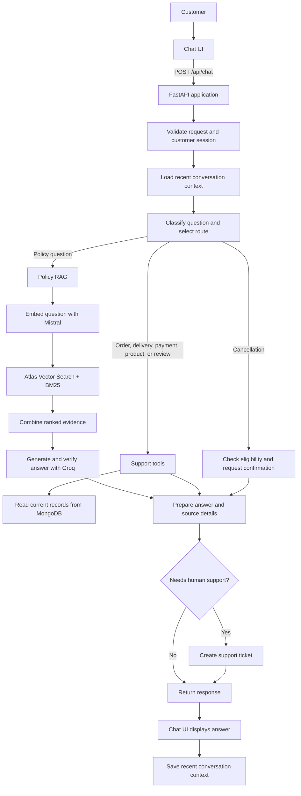

# Customer Support AI Agent

## Application flow



## Core steps

1. **Start:** The customer opens the chat UI. The FastAPI app loads its configuration, registers the routers, and exposes the chat API for the frontend. ([app/main.py](app/main.py), [app/api/chat.py](app/api/chat.py))
2. **Receive and validate:** The `POST /api/chat` endpoint validates the incoming payload, applies moderation checks, and verifies authorization or session data before business logic runs. ([app/api/chat.py](app/api/chat.py), [app/services/moderation.py](app/services/moderation.py), [app/services/demo_authorization.py](app/services/demo_authorization.py))
3. **Understand:** The classifier and orchestrator inspect the customer message and recent memory to route the request to policy, order, delivery, payment, product, cancellation, or escalation handling. ([app/agent/router.py](app/agent/router.py), [app/agent/intent_classifier.py](app/agent/intent_classifier.py), [app/services/conversation_memory.py](app/services/conversation_memory.py))
4. **Retrieve or act:**
   - **Policy:** The policy service embeds the question, retrieves approved chunks with hybrid search, and uses the grounded generator and verifier to produce a supportable answer. ([app/rag/service.py](app/rag/service.py), [app/rag/retrieval.py](app/rag/retrieval.py), [app/rag/generation.py](app/rag/generation.py))
   - **Account or support:** Support tools read current order, delivery, payment, product, or review records from the data store. ([app/agent/tools.py](app/agent/tools.py), [app/services/customer_accounts.py](app/services/customer_accounts.py), [app/storage/repository.py](app/storage/repository.py))
   - **Cancellation:** The workflow checks eligibility and asks for confirmation before attempting a change. ([app/services/cancellations.py](app/services/cancellations.py), [app/agent/router.py](app/agent/router.py))
5. **Respond and retain context:** The API assembles the answer, sources, actions, and memory diagnostics, returns the response to the UI, and stores relevant conversation history when enabled. ([app/api/chat.py](app/api/chat.py), [app/services/conversation_memory.py](app/services/conversation_memory.py))
6. **Escalate when needed:** When policy evidence is weak, the customer needs human follow-up, or a support ticket is required, the app creates a ticket and sends the appropriate update. ([app/services/support_tickets.py](app/services/support_tickets.py), [app/services/support_email.py](app/services/support_email.py))

## Policy preparation

Policy ingestion is a separate setup step, not something that happens merely
by starting the app. Approved policy source files are chunked, embedded, and
stored in MongoDB. Chat later searches those chunks. The Atlas Vector Search
index must be ready for vector retrieval.

```powershell
python -m app.rag.ingestion
uvicorn app.main:app --reload
```
