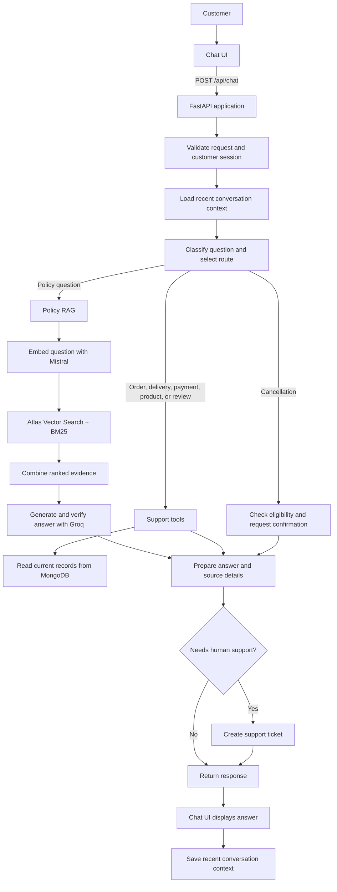

# Customer Support AI Agent

## Application flow



## Core steps

1. **Start:** The customer opens the chat UI. FastAPI loads configuration and registers the API routers. ([app/main.py](app/main.py))
2. **Send a chat message:** The UI sends `POST /api/chat`; the chat endpoint validates the request, checks moderation, and handles customer authorization where required. ([app/api/chat.py](app/api/chat.py), [app/services/moderation.py](app/services/moderation.py), [app/services/demo_authorization.py](app/services/demo_authorization.py))
3. **Understand and route:** The classifier and orchestrator use the message and available conversation context to select a policy, account-data, cancellation, or other route. ([app/agent/intent_classifier.py](app/agent/intent_classifier.py), [app/agent/router.py](app/agent/router.py), [app/services/conversation_memory.py](app/services/conversation_memory.py))
4. **Retrieve information or take action:**
   - **Policy questions:** The policy service searches approved chunks using hybrid retrieval and uses grounded answer generation and verification. ([app/rag/service.py](app/rag/service.py), [app/rag/retrieval.py](app/rag/retrieval.py), [app/rag/generation.py](app/rag/generation.py))
   - **Account questions:** Support tools read current order, delivery, payment, product, or review records from the data store. ([app/agent/tools.py](app/agent/tools.py), [app/services/customer_accounts.py](app/services/customer_accounts.py), [app/storage/repository.py](app/storage/repository.py))
   - **Cancellation:** The workflow checks eligibility and requests confirmation before attempting cancellation. ([app/services/cancellations.py](app/services/cancellations.py), [app/agent/router.py](app/agent/router.py))
5. **Return the response and retain context:** `POST /api/chat` returns the answer, sources, actions, and memory diagnostics. Conversation context can be saved for follow-up messages. ([app/api/chat.py](app/api/chat.py), [app/services/conversation_memory.py](app/services/conversation_memory.py))
6. **Escalate when needed:** If the agent cannot verify an answer or the customer needs human help, the app can create a support ticket and send a follow-up. ([app/services/support_tickets.py](app/services/support_tickets.py), [app/services/support_email.py](app/services/support_email.py))

## Policy preparation

Policy ingestion is a separate setup step, not something that happens merely
by starting the app. Approved policy source files are chunked, embedded, and
stored in MongoDB. Chat later searches those chunks. The Atlas Vector Search
index must be ready for vector retrieval.

```powershell
python -m app.rag.ingestion
uvicorn app.main:app --reload
```
