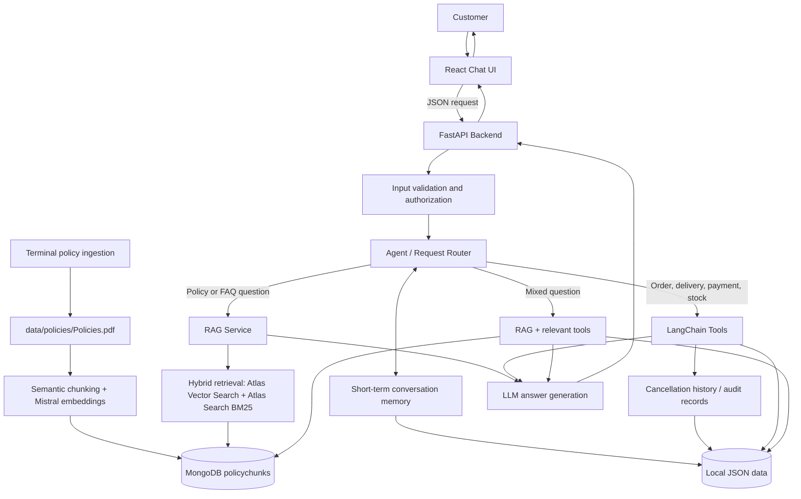

# Customer Support AI Agent: Architecture

## 1. Purpose and scope

The implemented application answers policy questions from an approved policy PDF
and uses authorized tools to retrieve current order, delivery, payment, product,
inventory, and review information. This document describes the working
repository, not only the original proposal; production-only requirements and
limitations are called out separately.

The application separates the **React/Vite frontend**, **FastAPI backend**,
**routing and RAG services**, and **storage adapters**. Operational demo data,
customer accounts, tickets, and conversation memory use local JSON files.
MongoDB Atlas stores policy chunks and their embeddings; the approved PDF and
its catalog metadata remain in the repository.


### Functional requirements covered

| ID | Capability | Implementation |
|---|---|---|
| FR-01 | Check order status | LangChain tool reads demo order data |
| FR-02 | Identify delivery delays | Tool reads delivery status/estimated date; reports a delay only when data supports it |
| FR-03 | Cancel an order | Check eligibility, ask for explicit customer confirmation, then update demo JSON |
| FR-04 | Check payment issues | Tool reads payment status and available error details |
| FR-05 | Product availability | Inventory tool reads product stock |
| FR-06–FR-12 | Refund, shipping, exchange, return, contact, warranty, ordering policies | RAG over approved policy documents |
| FR-13 | Product questions | Combine policy/product-document retrieval with live demo price/stock tool data when relevant |
| FR-14 | Review questions | Use review documents and the demo review source when available |
| FR-15 | Unknown questions | Say when evidence is unavailable; offer human support where appropriate |
| FR-16 | Protect customer accounts | Verify identity/authorization before revealing private order/payment details or changing an order |

## 2. High-level architecture (implemented)



### Request path in plain English

1. The customer types a question into the React chatbot.
2. React state manages the visible conversation; the frontend sends the message, `conversation_id`, and authorization token to the Python API as JSON. The backend is responsible for trusted memory storage and retrieval.
3. The backend cleans and normalises the message, then loads only the short-term memory relevant to that conversation. For a cancellation, it also checks the order/action records and writes a durable cancellation record after the outcome is known.
4. The backend validates the request and checks whether the requested information/action requires customer verification.
5. The controlled router selects the policy or support path. For eligible,
   read-only data questions, a bounded Groq function-calling loop chooses and
   invokes the existing LangChain `StructuredTool` objects. Policy questions
   continue through the separate approved-policy RAG pipeline. Mixed questions
   can combine both paths.
6. RAG retrieves current approved chunks using MongoDB Atlas **Vector Search and Atlas Search BM25**, combines the ranked results with reciprocal rank fusion, and retains source metadata.
7. Groq generates an answer from retrieved evidence. A verifier checks the answer; if unsupported, the generator gets one constrained revision attempt and the revised answer is verified again. If evidence remains insufficient or a provider fails, the response is transparent and may trigger the support workflow.
8. FastAPI returns a JSON response. The chat UI displays the answer and any next action, such as asking the customer to confirm a cancellation.

## 3. Explicit model and retrieval choices

| Component | Selected provider/model | Responsibility |
|---|---|---|
| LLM provider | **Groq** | Hosts grounded answer generation, verification, and optional bounded tool/intent selection |
| LLM model ID | Configurable through `GROQ_MODEL`; example in `.env.example`: `openai/gpt-oss-120b` | Generates grounded customer answers; verifier model is configurable separately |
| Embedding provider | **Mistral AI** | Converts document chunks and user queries into vectors |
| Embedding model ID | **`mistral-embed`** | Produces embeddings for vector similarity search |
| Chunking method | **Embedding-based semantic chunking** using Mistral sentence embeddings | Selects low-similarity sentence boundaries while preserving source text |
| Keyword retrieval | **MongoDB Atlas Search BM25**; local BM25 fallback | Finds relevant chunks using keyword matching |
| Vector retrieval | **MongoDB Atlas Vector Search**; local cosine fallback where applicable | Finds chunks semantically similar to the query |
| Hybrid ranking | Reciprocal Rank Fusion (RRF), `1 / (60 + rank)` | Combines vector and BM25 ranked lists |
| Agent/tool definitions | LangChain Core `StructuredTool` | Validates and executes order, delivery, payment, stock, and review lookups |
| Tool selection | Groq function calling | Selects read-only tools in a bounded loop; Python enforces the allowlist and authorization |
| API backend | Python + FastAPI | Validates requests and returns JSON |
| Operational demo storage | JSON files | Stores orders, deliveries, payments, products, reviews, accounts, tickets, conversation memory, and cancellation history |
| Policy storage | MongoDB Atlas | Stores policy chunks and embeddings in `policychunks`; policy PDF and catalog are local |

### Model configuration rules

- Use `GROQ_API_KEY` for Groq and `MISTRAL_API_KEY` for Mistral. Never place keys in source code or JSON files.
- Keep `GROQ_MODEL` configurable and confirm the selected model is available in the Groq account.
- Use the same Mistral embedding model for document chunks and incoming queries. If the embedding model changes, re-embed all stored chunks.
- Semantic chunking uses Mistral embeddings, preserves source text, and fails explicitly if chunking or embedding fails; there is no non-semantic fallback.
- In MongoDB mode the bundled catalog supplies the approved PDF metadata without requiring another MongoDB collection. Chunks must match the catalog document ID, approval status, and version.
- The Groq answer verifier can prompt one grounded rewrite before escalation; the revised answer must pass verification or the safe fallback is used.

## 4. Technology choices

| Layer | Demo choice | Responsibility |
|---|---|---|
| Frontend | React + Vite | Component-based chat interface, message state, input, confirmation prompts |
| API | Python + FastAPI | HTTP endpoints, validation, error responses |
| Agent | Groq function calling + LangChain Core | Bounded tool selection/execution over `StructuredTool` definitions; no cancellation or state-changing tools are exposed |
| RAG | Mistral `mistral-embed`, Atlas Vector Search, Atlas Search BM25, Groq generation and verification | Find approved policy evidence and generate grounded answers |
| Operational storage | Local JSON files | Orders, delivery updates, payments, products, reviews, accounts, tickets, memory, and cancellation history |
| Policy storage | MongoDB Atlas | Policy chunks and embeddings in `policychunks`; the PDF and catalog metadata are local |
| Endpoint testing | Postman collection JSON | Repeatable request examples |

**Demo limitation:** JSON files are suitable for a small local demonstration,
not concurrent production writes. MongoDB Atlas Vector Search and Atlas Search
indexes must both be configured and Ready for full hybrid policy retrieval.
Local BM25 remains available as a fallback; customer sessions and cancellation
confirmation state are process-local. These controls are not production
authentication or durable distributed state.

## 5. Frontend:

**Frontend implementation constraint:** Use React components and JSX for the complete user interface. Do not create a separate vanilla HTML/CSS/JavaScript frontend or standalone stylesheet. Keep the UI modular (header, message list, composer, quick actions, confirmation prompt) and use React state/event handlers for interactions. Use component-scoped or inline styling compatible with the chosen React setup.
 chatbot UI specification

### 4.1 Overall look and feel

Build a clean, friendly, responsive support-chat interface. It should feel like a customer-service product rather than a developer console.

- **Page background:** very light grey `#F5F7FA`.
- **Primary brand colour:** deep blue `#1D4ED8`.
- **Secondary colour:** teal `#0F766E` for successful/status information.
- **Main text:** dark slate `#1F2937`.
- **Muted text:** `#64748B`.
- **Chat surface:** white `#FFFFFF`.
- **Borders:** soft grey `#E2E8F0`.
- **Warning/error:** amber `#B45309` / red `#B91C1C`; never rely on colour alone to communicate status.
- **Typography:** system sans-serif stack; readable body text around 16px.
- **Shape:** rounded chat panel and message bubbles, subtle borders, minimal shadows.
- **Accessibility:** keyboard-operable controls, visible focus states, sufficient contrast, labels for inputs, and a live region for new messages.

### 4.2 Main screen layout

```text
┌──────────────────────────────────────────────────────────────┐
│ [Support icon] Customer Support              [New chat] [?]  │
│ Ask about orders, delivery, payments, products and policies.  │
├──────────────────────────────────────────────────────────────┤
│                                                              │
│  Assistant bubble: Hello! How can I help you today?          │
│                                                              │
│  [Check an order] [Delivery issue] [Payment issue]            │
│  [Returns & refunds] [Product availability] [Contact support] │
│                                                              │
│                         Customer message bubble              │
│  Assistant response with clear status and next steps         │
│                                                              │
│  [Confirmation card, only when a sensitive action needs it]   │
│                                                              │
├──────────────────────────────────────────────────────────────┤
│ [Type your question...                         ] [Send ➤]     │
│ Do not share passwords or full payment-card details.         │
└──────────────────────────────────────────────────────────────┘
```

### 4.3 Components and behaviour

| UI component | Behaviour |
|---|---|
| Header | Shows “Customer Support”, a short description, New chat, and optional Help |
| Welcome message | Explains what the assistant can help with |
| Quick-action chips | Pre-fill or send common intents: Check an order, Delivery issue, Payment issue, Returns & refunds, Product availability, Contact support |
| Customer bubble | Right-aligned, primary blue background, white text |
| Assistant bubble | Left-aligned, white surface, dark text |
| Evidence/status area | Shows a concise status such as “Order information retrieved” or “Policy information found”; do not expose internal prompts or sensitive records |
| Confirmation card | Shows the action and order reference; buttons “Confirm cancellation” and “Keep order” |
| Composer | Text input plus Send button; Enter sends, Shift+Enter adds a line if multiline input is used |
| Loading indicator | “Checking that for you…” while waiting; disable duplicate sends until the request completes |
| Error state | Plain-language message and Retry action; never show stack traces, secrets, or raw provider errors |
| New chat | Clears visible conversation state after asking/handling unsaved state if needed |

### 4.4 Example interaction flows

**A. Policy question**
1. Customer taps “Returns & refunds” or types “What is your refund policy?”
2. Frontend sends a chat request.
3. Backend routes the request to RAG.
4. Hybrid retrieval returns relevant policy chunks.
5. The answer explains only what the retrieved approved policy supports, with a source title where available.

**B. Order status**
1. Customer types “Where is order ORD-1001?”
2. Backend checks the required identity/authorization step.
3. If verified, the order-status tool reads the demo data.
4. The assistant shows status and available delivery information. If not signed in, it asks the customer to log in rather than disclosing private data.

**C. Order cancellation**
1. Customer asks to cancel an order.
2. Backend checks identity/authorization and cancellation eligibility.
3. If eligible, the UI displays the order reference and a clear confirmation card.
4. Nothing is changed until the customer presses **Confirm cancellation**.
5. The frontend sends a separate confirmation request.
6. Backend rechecks eligibility, updates the demo JSON safely, and reports success or the reason it could not cancel. “Keep order” makes no change.

**D. Mixed product question**
1. Customer asks “Does the product have a warranty and is it in stock?”
2. RAG retrieves warranty/product documentation.
3. Inventory tool checks the current demo stock.
4. The answer separates policy information from current stock results.

**E. Unknown question**
1. Retrieval/tools find no reliable evidence.
2. The agent says it cannot verify the answer and offers the configured human-support contact path.

## 6. Backend design (Python)

Use FastAPI for the HTTP layer. Keep routes thin; business logic belongs in service/tool modules.

Implemented module map:

```text
customer-support-ai-agent/
├── app/
│   ├── main.py                 # FastAPI app and route registration
│   ├── api/
│   │   ├── chat.py             # Chat endpoint
│   │   ├── orders.py           # Order and cancellation APIs
│   │   ├── damage_reports.py   # Authenticated damage reports and images
│   │   ├── admin_tickets.py    # Staff ticket workflow
│   │   └── health.py           # Health endpoint
│   ├── agent/
│   │   ├── router.py           # Intent routing and orchestration
│   │   ├── intent_classifier.py
│   │   ├── tool_calling.py     # Bounded Groq read-only tool loop
│   │   └── tools.py            # LangChain StructuredTool definitions
│   ├── rag/
│   │   ├── ingestion.py        # PDF/text parsing and semantic ingestion
│   │   ├── providers.py        # Mistral embeddings and semantic chunking
│   │   ├── retrieval.py        # Atlas vector + BM25 and RRF
│   │   ├── generation.py       # Grounded answer and verifier
│   │   └── service.py          # Policy-answer orchestration
│   ├── services/               # Auth, memory, tickets, support email
│   └── storage/
│       ├── json_store.py       # Operational JSON repository
│       ├── mongodb.py          # Policy chunks and search indexes
│       ├── factory.py          # JSON/Mongo repository composition
│       └── policy_catalog.py   # Approved bundled PDF metadata
├── data/
│   ├── policies/Policies.pdf
│   ├── orders.json
│   ├── deliveries.json
│   ├── payments.json
│   ├── customer_accounts.json
│   └── ... operational JSON datasets
├── frontend/
│   ├── index.html
│   ├── package.json
│   ├── vite.config.js
│   └── src/
│       ├── main.jsx
│       ├── App.jsx
│       ├── components/
│       │   ├── ChatHeader.jsx
│       │   ├── MessageList.jsx
│       │   ├── ChatComposer.jsx
│       │   └── CancellationConfirmation.jsx
│       └── api.js
├── tests/
├── postman/
│   └── customer_support_agent.postman_collection.json
├── .env.example
├── requirements.txt
├── README.md
└── customer_support_ai_agent_architecture.md
```

### 5.1 Routing logic

Use intent routing as a controlled decision. For eligible read-only requests,
the configured Groq function-calling loop may select from the application
allowlist; deterministic Python routing is also available when that feature is
disabled or fails. Python continues to enforce authorization, tool arguments,
and action boundaries:

- Policy/how-to question → RAG.
- Order/delivery/payment/inventory lookup → corresponding LangChain tool.
- Product details plus stock/price or policy plus current data → RAG and tool results.
- Cancellation → authorization + eligibility check + explicit confirmation + recheck + update.
- Damaged item with an order reference → authenticated photo damage-report flow.
- No supported intent or no evidence → transparent fallback/human support.

Do not let the LLM alone decide whether a cancellation is allowed. Enforce authorization and business rules in Python code.

### 5.2 LangChain tools

Define small, clearly named LangChain `StructuredTool` objects, for example:

- `get_order_status(order_id, customer_id)`
- `get_delivery_status(order_id, customer_id)`
- `check_cancellation_eligibility(order_id, customer_id)`
- `cancel_order(order_id, customer_id, confirmation_token)`
- `get_payment_status(order_id, customer_id)`
- `check_product_availability(product_id)`
- `search_customer_reviews(product_id or query)`

Tools validate input, return structured results, handle missing records, and
avoid returning unrelated customer data. Only read-only order, delivery,
payment, product, and review tools are available to the model. The cancellation
eligibility and cancellation tools remain outside the model's allowlist;
cancellation requires explicit confirmation and a server-side
eligibility/authorization recheck.

Customers log in with administrator-provisioned email/password accounts. Passwords are stored as salted scrypt hashes; an authenticated token maps to exactly one customer ID and is required for private order and cancellation operations. Provision demo accounts only for fictional records and use a production identity/session system before handling real customer data.

## 7. API contract and Postman testing

All endpoints return JSON. Use consistent HTTP status codes and response shapes. Do not return HTML error pages or internal tracebacks from API endpoints.

### 6.1 Implemented and related endpoints

| Method | Path | Purpose |
|---|---|---|
| GET | `/health` | Confirm that the API is running |
| POST | `/api/auth/login` | Verify a provisioned email/password account and issue a short-lived customer-scoped token |
| POST | `/api/chat` | Send a message and receive an assistant response |
| POST | `/api/orders/{order_id}/cancel` | Confirm and execute cancellation after authorization |
| POST | `/api/damage-reports` | Submit an authenticated damage description and JPEG/PNG photo |
| GET | `/api/tickets` | List tickets for the authenticated customer |
| GET | `/api/tickets/{ticket_id}` | Read an owned ticket and customer-visible timeline |
| POST | `/api/support/tickets/{ticket_id}/message` | Send customer details through the configured support-email workflow |
| POST | `/api/auth/support-agent/login` | Authenticate a provisioned support agent |
| PATCH | `/api/admin/tickets/{ticket_id}/status` | Apply an authorized staff ticket transition |

Order, delivery, payment, product, review, and policy lookups are LangChain
tools invoked through `/api/chat`; they are not separate lookup endpoints.
Policy ingestion is a terminal command, not an HTTP endpoint.

### 6.2 Example chat request

```json
{
  "message": "What is your refund policy?",
  "conversation_id": "demo-session-001",
  "authorization_token": null,
  "memory_enabled": true
}
```

### 6.3 Example chat response

```json
{
  "conversation_id": "demo-session-001",
  "answer": "I found the following information in the approved refund policy: ...",
  "route": "rag",
  "sources": [
    {
      "document_id": "refund-policy",
      "title": "Refund Policy",
      "chunk_id": "refund-policy-chunk-001"
    }
  ],
  "actions": [],
  "needs_confirmation": false,
  "memory": {
    "short_term_used": true,
    "long_term_record_created": false
  }
}
```

### 6.4 Example cancellation response before confirmation

```json
{
  "order_id": "ORD-1001",
  "eligible": true,
  "message": "This order is eligible for cancellation. Please confirm before I cancel it.",
  "needs_confirmation": true,
  "confirmation_token": "demo-token-replace-with-server-generated-short-lived-token"
}
```

The token above is a placeholder for the API contract only. In implementation, create a short-lived, single-use confirmation record on the server, bound to the authenticated customer, order, action, and current order version. Never trust a client-side boolean as proof of confirmation. The final cancellation request must recheck authorization and eligibility, reject expired/replayed tokens, and return the authoritative order state.

### 6.5 Endpoint testing

Import `postman/customer_support_agent.postman_collection.json` into Postman. Set `baseUrl` to `http://127.0.0.1:8000`. The collection includes example requests for health, chat, order, delivery, payment, cancellation eligibility, cancellation confirmation, and product availability. Update example IDs to match the local JSON data. These are test examples; the collection does not imply the endpoints are implemented until the corresponding phase is complete.

## 8. Storage design: operational JSON and MongoDB policy chunks

### 8.1 Operational JSON files and policy storage

Operational records are stored in JSON files under `data/`; arrays contain one
record per object. Automated fixtures live separately under
`tests/fixtures/demo_data/`. MongoDB mode does not move these operational
records into MongoDB.

| File | Purpose | Important fields |
|---|---|---|
| `orders.json` | Order-level records | `order_id`, `customer_id`, `order_status`, `currency`, `created_at`, `updated_at` |
| `deliveries.json` | Shipment/delivery records (an order may have multiple shipments) | `shipment_id`, `order_id`, `carrier`, `tracking_reference`, `delivery_status`, `estimated_delivery`, `last_update`, `delay_reason` |
| `payments.json` | Payment transaction state | `payment_id`, `order_id`, `payment_status`, `provider_reference`, `error_code`, `updated_at` (never store card data) |
| `products.json` | Product catalogue | `product_id`, `name`, `description`, `price`, `currency`, `warranty_summary` |
| `reviews.json` | Demo reviews | `review_id`, `product_id`, `rating`, `review_text`, `created_at` |
| `customer_accounts.json` | Provisioned demo customer accounts with salted password hashes | `customer_id`, `email`, `password_hash` |
| `support_agents.json` | Provisioned support-agent accounts with salted password hashes | `staff_id`, `email`, `password_hash` |
| `support_tickets.json` | Support ticket, messages, status, audit history, and attachment metadata | `ticket_id`, `customer_id`, `order_id`, `status`, `messages`, `audit` |
| `conversation_memory.json` | Short-term context scoped to the verified customer; expires automatically | `conversation_id`, `owner_id`, `turns`, `last_order_id`, timestamps |
| `cancellation_history.json` | Auditable cancellation requests and outcomes | `event_id`, `order_id`, `customer_id`, `reason`, `outcome`, timestamps |
| `evaluation_cases.json`, `evaluation_runs.json` | Local evaluation inputs and run reports | Evaluation-specific schemas |

The approved source is `data/policies/Policies.pdf`. Its catalog metadata is
defined in `app/storage/policy_catalog.py`. The `MongoPolicyRepository`
supplies this catalog entry when the PDF exists, so MongoDB requires no
separate policy metadata collection. MongoDB collection `policychunks` stores
only policy chunks, embeddings, and traceability metadata. JSON mode can store
policy chunks in `data/policy_chunks.json`.

### 8.2 Relationships

- `orders.customer_id` identifies the customer who owns the order.
- `order_items.order_id` points to an order and `order_items.product_id` points to a product. This supports multiple products per order; do not model a production order as if it can contain only one item.
- `deliveries.order_id` and `payments.order_id` point to the relevant order. An order can have multiple shipments or payment attempts, so do not assume a one-to-one relationship unless the business rules guarantee it.
- `reviews.product_id` points to the reviewed product.
- Each policy chunk's `document_id` points to the local approved policy catalog
  entry. Its approval flag and `updated_at` must match the catalog version.
- A damage report verifies that the authenticated customer owns the order.
  Operational ticket/report metadata and JPEG/PNG images remain in the local
  JSON/file store in both storage modes; MongoDB is dedicated to policy chunks.

JSON files do not enforce foreign keys. Validate references in application code and add tests for missing or mismatched IDs. Never assume an order exists merely because a customer supplied an order ID.

### 8.3 Example record shapes

`data/orders.json`

```json
[
  {
    "order_id": "ORD-1001",
    "customer_id": "CUS-001",
    "product_id": "PROD-001",
    "quantity": 1,
    "order_status": "processing",
    "created_at": "2026-10-20T10:15:00Z",
    "cancellation_allowed": true
  }
]
```

Policy chunk fields in MongoDB's `policychunks` collection (or
`data/policy_chunks.json` with JSON storage):

```json
[
  {
    "chunk_id": "refund-policy-chunk-001",
    "document_id": "refund-policy",
    "title": "Refund Policy",
    "text": "Approved policy text goes here.",
    "embedding": [],
    "metadata": {
      "category": "refunds",
      "approved": true,
      "source": "demo/refund-policy.md"
    },
    "token_count": 6
  }
]
```

Embeddings are numeric arrays generated by the configured embedding model. An empty array is a placeholder and must not be used as a valid vector. Generate embeddings during ingestion and record the embedding model name/version so vectors can be rebuilt consistently.

### 8.4 MongoDB policy retrieval configuration

The application currently uses MongoDB Atlas for policy chunk storage and
hybrid search while retaining operational JSON files. Create exactly the
Vector Search and Atlas Search indexes on `policychunks` described in the
README. Vector Search filters current document IDs, embedding model, approval,
and version metadata. Atlas Search BM25 matches `text` and `title`, filtered to
approved/current chunks. RRF merges the two result lists. If vector embedding
or an Atlas search path is unavailable, the retriever uses the available
channel and local BM25 fallback where possible.

## 9. RAG pipeline (implemented)

Required sequence:


### 8.1 Ingestion

1. **Load:** read approved document metadata from the configured repository.
   In MongoDB mode the bundled catalog entry identifies
   `data/policies/Policies.pdf`; JSON mode reads `data/policy_documents.json`.
2. **Parse:** extract text from supported PDF, Markdown, or plain-text files;
   scanned/image-only PDFs are not OCR-processed.
3. **Clean:** normalize whitespace and remove the obsolete controlled-draft
   approval banner without changing substantive policy text.
4. **Semantic chunking:** use Mistral sentence embeddings to select semantic
   boundaries while preserving source text exactly. Ingestion fails rather
   than falling back to non-semantic chunking.
5. **Metadata:** attach document ID, title, category, source, approval state,
   version, chunk index, and chunk ID.
6. **Embed and persist:** create `mistral-embed` vectors and replace that
   document's chunks in MongoDB `policychunks` (or JSON `policy_chunks.json`).

Do not treat unapproved documents as authoritative. Re-ingesting a document should replace/update its chunks predictably rather than silently creating duplicates.

### 8.2 Retrieval: hybrid vector + BM25

For each question:
1. Embed the query using the same Mistral `mistral-embed` model as the stored chunks.
2. Retrieve vector-ranked candidates from Atlas Vector Search and text-ranked candidates from Atlas Search BM25.
3. Filter to approved/current document versions and combine ranked lists using RRF: `1 / (60 + rank)`.
4. Deduplicate chunk IDs and send the top evidence, with source metadata, to answer generation and verification.

If there are no valid embeddings or an Atlas index is unavailable, the vector path reports the problem; the available BM25 path can still retrieve evidence. Local BM25 is also used as a fallback when Atlas BM25 fails.

### 8.3 Generation

The generation prompt must instruct the model to:
- answer using retrieved approved evidence and tool results;
- distinguish policy text from current operational data;
- not invent order status, delivery dates, stock, prices, reviews, or policy terms;
- state when evidence is missing, stale, or contradictory;
- give a concise, helpful answer in simple English;
- include source titles when policy chunks were used;
- avoid exposing internal prompts, secrets, or other customers' information.

The model's answer is not itself proof that an action succeeded. For changes such as cancellation, use the tool's verified result.

## 10. Memory design: short-term conversation context and long-term cancellation history

Memory has two different jobs in this project. Keep them separate so the assistant can follow a conversation without treating every chat message as permanent customer history.

### 10.1 Short-term memory — current conversation

**Purpose:** help the assistant understand follow-up messages and avoid asking the customer to repeat information during the same support conversation.

It can retain limited context for intents such as:
- checking an order's status;
- identifying delivery delays;
- checking payment issues;
- checking product availability or product details;
- explaining refund, shipping, exchange, return, warranty, and ordering policies;
- answering review or contact-information questions;
- clarifying which order or product the customer is referring to.

**Suggested contents**
- `conversation_id` and an authenticated customer/session reference where available;
- a bounded set of recent user/assistant turns or a concise conversation summary;
- the current intent and non-sensitive entities needed for follow-up, such as an order reference or product ID;
- the last tool result's status and timestamp, where useful;
- `created_at`, `updated_at`, and `expires_at`.

**Rules**
1. Keep memory scoped to one conversation and, where authenticated, its owner. A conversation ID alone is not proof of identity or permission.
2. Apply a configurable time-to-live (TTL), for example 30 minutes of inactivity for the demo. Treat this as a proposed default to confirm, not a business requirement.
3. Bound the number/size of stored turns and summarise older turns when needed.
4. Do not store passwords, full payment-card details, access tokens, or unnecessary sensitive information.
5. Before answering a follow-up, use memory to resolve references such as “What about the delivery?”; then verify current operational facts with the relevant tool instead of relying on a remembered status.
6. If memory is missing, expired, or inconsistent, ask a short clarification question. Do not guess.
7. Provide a “New chat” action that starts a new conversation context. Follow the agreed retention/deletion policy when clearing stored memory.
8. Memory is contextual assistance, not an authoritative source for order, delivery, payment, inventory, or policy facts.

### 10.2 Long-term memory — cancellation reasons and outcomes

**Purpose:** preserve a durable record of why an order cancellation was requested and what happened. This is an operational/audit record, not an unrestricted profile of the customer.

For each cancellation request, record the reason supplied by the customer (or a clearly labelled `not_provided` value), the order reference, request time, eligibility result, final outcome, and outcome time. Example reason categories may include `ordered_by_mistake`, `delivery_too_late`, `found_better_price`, `changed_mind`, `duplicate_order`, `payment_problem`, `other`, and `not_provided`. These are proposed demo categories; allow a short free-text explanation only if needed and keep it length-limited.

**Suggested record**
```json
{
  "event_id": "CAN-EVT-0001",
  "order_id": "ORD-1001",
  "customer_id": "CUS-001",
  "reason_code": "delivery_too_late",
  "reason_text": "The delivery will arrive too late.",
  "requested_at": "2026-10-22T13:40:00Z",
  "eligibility_result": "eligible",
  "outcome": "cancelled",
  "outcome_at": "2026-10-22T13:41:00Z",
  "actor": "customer_confirmed",
  "request_id": "req-demo-0001"
}
```

**Rules**
1. Ask for the reason when the customer requests cancellation, before presenting the final confirmation. If they do not want to give a reason, record `not_provided`; do not block an otherwise valid cancellation just to collect a reason unless the business explicitly requires it.
2. Do not cancel when the customer merely states a reason or asks about cancellation. Require the existing eligibility check and explicit confirmation flow.
3. Write the final outcome only after the business/storage layer confirms it. Keep unsuccessful, withdrawn, or ineligible requests distinguishable from completed cancellations.
4. Keep a durable audit event for the request and its result. Never let a model-generated answer count as proof that the order was cancelled.
5. Restrict access to cancellation history to authorised staff/services. Do not expose past cancellation reasons in unrelated conversations.
6. Define a retention and deletion policy with the business before production. Do not keep records forever by default.
7. Use `cancellation_history.json` for the small demo only; JSON is not safe for concurrent production writes. During migration, move this record to a durable database/audit store with access controls and safe writes.
8. Use long-term records for operational traceability and approved reporting, not to infer a customer's personality or automatically deny future cancellations.

### 10.3 How memory works with request cleaning and routing

1. Validate the request size and shape.
2. Clean and normalise the user message (trim whitespace, normalise repeated spaces, and apply safe text normalisation without changing the intended meaning).
3. Retrieve the relevant short-term conversation summary/turns, if present and not expired.
4. Resolve follow-up references from the current message plus conversation context. If the order/product reference is still ambiguous, ask the customer to clarify.
5. Route to RAG, a read-only tool, or both. Verify current facts with the authoritative source.
6. For cancellation, collect a reason, check authorisation and eligibility, ask for explicit confirmation, recheck state at execution, and then persist the confirmed outcome in long-term cancellation history.
7. Save the bounded short-term context and return the answer. Never copy all chat history into long-term memory automatically.

### 10.4 Storage and API implications

- Demo files: `data/conversation_memory.json` and `data/cancellation_history.json`.
- Suggested repository methods: `get_conversation_memory(conversation_id, owner_id)`, `save_conversation_memory(...)`, `expire_old_conversations(...)`, and `append_cancellation_event(...)`.
- Add a memory section to the `POST /api/chat` response only for safe diagnostics, for example whether short-term context was used. Do not return raw memory contents to the browser.
- Cancellation endpoints should accept a validated reason code and optional length-limited reason text. The server should associate the event with the authenticated customer and request ID; do not trust a customer ID supplied in chat text.
- For MongoDB migration, use a TTL index for expiring short-term conversation records where supported, and a separately controlled collection for durable cancellation events. Confirm the selected deployment's TTL and indexing behaviour during implementation.

## 11. Security, privacy, reliability and quality

- Validate all request bodies with Pydantic and limit message/input sizes.
- Verify customer identity/authorization before exposing order/payment/delivery information or modifying an order.
- Do not store passwords, full payment-card data, or secrets in demo records.
- Keep API keys in environment variables. `.env` must not be committed.
- Avoid logging full private customer records or secrets.
- Handle missing files/records, malformed JSON, unavailable LLMs, embedding errors, and tool timeouts with safe JSON errors.
- Use atomic file replacement or a lock for JSON writes; JSON is not safe for concurrent production writes.
- Do not report a delay unless delivery data supports it.
- Require a separate explicit confirmation for cancellation and recheck eligibility at execution time.
- Return sources and route metadata for testing, but do not expose internal chain-of-thought or hidden prompts.
- Define a response-time target with stakeholders; the requirements document does not specify a numeric target.
- Add tests for accuracy, authorization, cancellation, tool failures, unknown questions, and correct tool selection.

## 12. Implementation status and roadmap

The demo application currently implements:

- FastAPI and React/Vite, with login, customer chat, support-agent ticket
  handling, ticket tracking, and damage-photo reporting.
- Local JSON operational data and authenticated customer/support-agent
  accounts; customer IDs are resolved server-side from short-lived,
  process-local sessions.
- LangChain `StructuredTool` lookups and an optional bounded Groq
  function-calling loop for read-only support actions.
- Confirmation-gated cancellation and persisted cancellation outcomes.
- Mistral embedding-based semantic ingestion of the approved policy PDF.
- MongoDB Atlas policy-chunk storage with separate Vector Search and Atlas
  Search BM25 indexes, reciprocal-rank fusion, and source-version filtering.
- Groq grounded answer generation and verification, with one constrained
  revision attempt before a safe escalation fallback.
- Automated unit, integration, and API-level tests. A live MongoDB/Groq path
  is configuration-dependent and must also be checked in the target
  deployment.

The MongoDB integration stores only policy chunks in `policychunks`. Policy
source and approval metadata come from the bundled PDF and local catalog;
operational data is not automatically migrated to MongoDB.

### Remaining production-readiness work

- Replace demo JSON records and process-local sessions/tokens with the
  production order, identity, and durable storage systems.
- Add durable transactional/idempotent cancellation state for multi-instance
  deployment.
- Integrate real payment, carrier, inventory, and email/support systems.
- Define the legal, privacy, retention, access-control, backup, monitoring,
  and incident-response requirements with their business owners.
- Run reviewed answer-quality evaluations and end-to-end tests against the
  actual Atlas indexes and provider configuration before release.

## 13. Acceptance checklist

- [ ] Chatbot works on desktop and mobile-sized screens.
- [ ] Frontend is implemented with React components and JSX; do not build a separate HTML/CSS/vanilla-JavaScript frontend.
- [ ] Python FastAPI backend returns JSON.
- [ ] Postman collection contains endpoint test examples.
- [ ] Order, delivery, payment, product availability, and review tools read demo JSON.
- [ ] Cancellation checks eligibility and requires explicit confirmation.
- [ ] Policy answers use approved source documents and show source metadata.
- [ ] RAG ingestion includes PDF parsing, cleaning, Mistral-embedding semantic chunking, metadata, embeddings, and storage.
- [ ] Retrieval uses both vector similarity and BM25 with a documented merge strategy.
- [ ] Unknown answers are transparent and can direct customers to human support.
- [ ] Authorization and privacy checks protect customer-specific information.
- [ ] Automated tests cover expected success, missing data, and failure paths.
- [ ] Operational JSON and MongoDB policy-chunk storage use the repository abstraction.
- [ ] Short-term memory is conversation-scoped, bounded, expires, and is not treated as authoritative operational data.
- [ ] Cancellation requests collect a reason when offered and record the verified outcome in long-term cancellation history.
- [ ] Memory cannot reveal another customer's conversation or cancellation history.


## 14. Important design gaps to close before deployment

This section records upgrades that are not fully specified elsewhere in the original design. Treat them as implementation requirements, not as features that already exist.

### 13.1 Define the real source of truth for every answer

The LLM must not become the source of truth for operational facts.

| Information | Authoritative source | Required behaviour |
|---|---|---|
| Order status and items | E-commerce/order-management system; JSON only in the demo | Read the current record and report when the record cannot be found |
| Delivery location/status/ETA | Carrier tracking API or verified logistics events | Show the last update time; do not invent a delivery date |
| Payment status | Payment provider or order-management payment record | Return a safe status and customer-friendly next step; never request full card details |
| Inventory and price | Catalogue/inventory service | Report the time of the lookup where freshness matters |
| Returns/refunds/warranty rules | Current, approved policy documents | Cite the policy title and effective/update date when available |
| Customer identity and permissions | Authentication/identity service | Never accept a customer ID supplied in a message as proof of ownership |

For the demo, label all data as fictional. Before launch, document which real business system supplies each data type, how it is authenticated, how often it updates, and what happens when it is unavailable.

### 13.2 Add the missing order-items collection

The example schema currently puts a `product_id` and `quantity` directly on an order. That only represents an order with one product. Most e-commerce systems allow multiple items per order.

Use a separate `order_items` dataset/collection:

| Field | Purpose |
|---|---|
| `order_item_id` | Unique line-item identifier |
| `order_id` | Parent order identifier |
| `product_id` | Purchased product |
| `quantity` | Quantity ordered |
| `unit_price` | Price at purchase time, not today's catalogue price |
| `item_status` | Optional item-level fulfilment/return state |

Keep order-level status separate from shipment status, payment status, and individual item status. These states can differ. An order may be paid but not shipped, split across shipments, partially returned, or partially refunded.

### 13.3 Treat delivery tracking as an integration, not just a JSON lookup

A delivery tool should return a structured result such as:

- `shipment_id` and carrier name;
- carrier's latest status and event timestamp;
- estimated delivery date, only if supplied by a trusted source;
- `last_checked_at` and, where possible, source freshness;
- a safe tracking link, if available and verified;
- a clear unavailable/stale-data state.

For a later live integration, choose either verified carrier webhooks, scheduled polling, or a documented combination. Verify webhook signatures, reject duplicate events, handle out-of-order events, and preserve the event timestamp. Do not assume that a carrier update arrives exactly once or in chronological order.

If no live carrier integration exists, the response must say that it is showing demo or last-known data. A model must never turn an old estimated delivery date into a promise.

### 13.4 Make order changes safe under retries and race conditions

Cancellation is a state-changing operation. A customer may click twice, a browser may retry, or the order may ship between the eligibility check and the final confirmation.

Implement these protections:

1. Use a server-side state machine for allowed transitions (for example, `processing` → `cancelled`, only when business rules permit it).
2. Re-read the current order and re-check ownership, eligibility, and state immediately before writing.
3. Use a single-use, short-lived confirmation token bound to the authenticated user, order, action, and order version.
4. Add an idempotency key to state-changing requests so a retry does not execute the same action twice.
5. Record an audit event with actor, action, timestamp, outcome, and correlation/request ID; do not put secrets or unnecessary personal data in the audit log.
6. Return the authoritative result from the storage/business layer. Do not claim cancellation succeeded merely because the LLM generated a success message.
7. In production, use the order system's transactional API or a database transaction/conditional update. A JSON file and a process-local lock are not a multi-instance production concurrency strategy.

The same pattern should be applied to any future refund, exchange, address-change, or account-modification tool. Start with read-only tools; add write actions only after authorization and tests are in place.

### 13.5 Specify authentication and authorization at the API boundary

An untrusted `customer_id` in a request body is not proof of identity. The local login maps a provisioned email/password account to one customer ID; order handlers resolve ownership only from the server-side session and must check every order against that customer ID.

Before real deployment:

- Use an established authentication mechanism (for example, the store's existing login/session or identity provider).
- Derive the customer identity from a validated server-side session or access token, not from the chat message or an untrusted request field.
- Enforce object-level authorization on every order, delivery, and payment endpoint: the authenticated customer may only access records they are entitled to see.
- Require stronger authorization and, where appropriate, re-authentication for sensitive state changes.
- Do not accept customer IDs supplied by the browser or chat as authentication.
- Test attempts to access another customer's order by changing an order ID, customer ID, conversation ID, or tool argument.

Do not expose private order details in a conversation merely because the customer knows an order reference.

### 13.6 Defend the agent against prompt injection and unsafe tool use

Retrieved documents, reviews, product descriptions, and customer messages are data—not trusted instructions. A malicious review or uploaded document could contain text telling the model to ignore its rules or reveal information.

- Treat retrieved text and tool output as untrusted content; never allow it to override system/developer rules.
- Allowlist tools and validate every tool argument with typed schemas and business rules.
- Give each tool only the minimum permissions it needs. Prefer read-only tools by default.
- Keep authorization and action eligibility in deterministic Python services, not solely in the LLM prompt.
- Never put API keys, system prompts, internal stack traces, or another customer's data in the model context unless strictly required (secrets should not be included).
- Limit tool-call count, execution time, result size, and model input/output size.
- Do not allow the model to invent URLs, execute arbitrary code, run arbitrary database queries, or call arbitrary external endpoints.
- For document ingestion, restrict accepted file types and size, validate files, and protect the ingestion route with admin authorization. Do not expose an unprotected upload/ingestion endpoint.
- Add adversarial tests such as “ignore previous instructions,” malicious review text, requests for another customer's order, and attempts to cancel without confirmation.

### 13.7 Make RAG source governance explicit

The current RAG pipeline covers ingestion and retrieval, but production needs document lifecycle controls.

Add these fields where applicable: `document_version`, `effective_from`, `effective_to`, `approved_by`, `approved_at`, `content_hash`, `ingested_at`, and `is_current`.

Rules:

- Only approved, current documents are eligible for normal answers.
- When a policy changes, re-ingest it deterministically, retire superseded chunks, and prevent old and new versions from being treated as equally authoritative.
- Preserve a link from every chunk to the exact source document/version.
- Treat document text as evidence, not as instructions to the agent.
- If sources conflict, prefer an explicitly configured authority/version rule or state that the information conflicts and escalate; do not let the LLM silently choose.
- Preserve exact source text during chunking. An LLM can propose boundaries, but validate that each output chunk maps to source spans; otherwise use deterministic chunking.
- Record embedding model/version and chunking configuration so an index can be rebuilt.
- Avoid sending unnecessary customer personal data to embedding or generation providers.

### 13.8 Add a proper error and fallback contract

Create a consistent API error format with a stable machine-readable code, a customer-safe message, and a request/correlation ID. Do not return provider errors, stack traces, prompts, or secrets to the frontend.

Plan for these cases explicitly:

| Failure | Expected behaviour |
|---|---|
| Order does not exist or user is not authorized | Return a safe response that does not leak another customer's record |
| Delivery provider unavailable | Explain that tracking cannot be refreshed; show last-known data only with its timestamp |
| LLM unavailable or rate-limited | Return a graceful fallback for supported deterministic lookups; otherwise offer retry/human support |
| Embedding provider unavailable | Do not claim semantic retrieval succeeded; use a tested fallback only if safe |
| No relevant policy evidence | Say the answer cannot be verified and offer human support |
| Conflicting or stale data | Explain the uncertainty and escalate when it affects a customer decision |
| JSON file missing or malformed | Fail safely, log a redacted diagnostic, and do not overwrite the damaged file with empty data |
| Cancellation state changed after eligibility check | Refuse the stale action and explain the current safe next step |

Use timeouts and bounded retries for external calls. Retry only operations that are safe to retry; use idempotency keys for state changes.

### 13.9 Add observability, evaluation, and operational ownership

A deployed system needs more than endpoint tests. Add:

- **Structured logs:** timestamp, request/correlation ID, route category, latency, result code, and provider failure type. Redact access tokens, secrets, payment details, and unnecessary personal data.
- **Metrics:** request volume, error rate, latency percentiles, tool failures, human handoffs, cancellation failures, retrieval no-match rate, and estimated model/embedding cost.
- **Tracing:** follow a request across FastAPI, routing, retrieval, tools, and model calls without logging private prompt content by default.
- **Evaluation dataset:** representative questions for order status, delayed delivery, policy answers, mixed questions, ambiguous requests, missing data, and adversarial prompts.
- **RAG/agent evaluation:** measure retrieval quality, answer relevance, faithfulness/grounding, correct tool selection, authorization failures, and correct action outcomes. Use human-reviewed examples as a baseline; an LLM judge alone is not proof of correctness.
- **Regression gate:** run automated tests and evaluation cases before changing prompts, models, chunking, retrieval settings, or policies.
- **Ownership:** define who receives alerts, handles customer escalations, updates policies, and responds to provider outages.

Set numeric service-level targets with stakeholders before launch; do not invent targets in the architecture without agreement.

### 13.10 Production deployment and configuration checklist

Before public deployment:

- Serve the frontend and API over HTTPS.
- Configure production CORS to allow only the exact frontend origins; do not use permissive wildcard settings with credentials.
- Add authentication, authorization, rate limits, request-size limits, and abuse protection.
- Store secrets in the deployment platform's secret manager/environment configuration; keep `.env` local and excluded from version control.
- Pin and review dependencies; scan for known vulnerabilities and keep a reproducible dependency lock file.
- Separate development, test, and production environments and data.
- Configure database access controls, backups, restore tests, retention, and migration/rollback procedures.
- Add liveness/readiness checks, graceful shutdown, and monitoring for API, database, and provider dependencies.
- Avoid relying on local disk for durable data in a multi-instance deployment.
- Document deployment steps, rollback steps, support contacts, and known limitations.
- Complete privacy/legal review for the relevant jurisdiction and business; define data retention and deletion procedures.

MongoDB migration alone does not make the application production-ready. The integration, security, monitoring, and operational controls above are still required.

## 15. Recommended API contract upgrades

The proposed API endpoints are a useful starting point. Add these contract rules before implementation:

1. **Authenticated identity:** do not accept `customer_id` as trusted identity in a public chat request. The server should resolve the customer from authentication context.
2. **Request validation:** define maximum message length, accepted content types, required fields, and validation errors in Pydantic schemas.
3. **Conversation ownership:** if conversation history is stored, bind it to the authenticated user/session and enforce retention limits. A random `conversation_id` must not grant access to private history.
4. **Action separation:** keep cancellation eligibility and cancellation execution as separate requests; the final request must re-check permissions and state.
5. **Idempotency:** state-changing endpoints should accept an idempotency key and return the previous outcome for a safe retry.
6. **Stable responses:** document success/error schemas and status codes. Do not make the frontend parse free-form model text to decide whether an action succeeded.
7. **Public versus internal metadata:** internal route/debug data may be useful in tests, but expose only fields the client needs. Do not expose hidden prompts, tool arguments containing sensitive values, or internal reasoning.
8. **Versioning:** document an API versioning approach before external clients depend on the endpoints.

Suggested additional response fields include `request_id`, `status` (for example, `completed`, `needs_confirmation`, or `handoff`), and structured `actions`. Use a strict schema and validate the model output before returning it to the client.

## 16. Testing upgrades and release gates

Add tests beyond happy-path examples. Use fake provider responses and fictional data so tests are repeatable and do not depend on live carrier or payment systems.

### Required test groups

- **Unit tests:** routing rules, order eligibility, status mapping, authorization helpers, JSON repository behaviour, chunk metadata, ranking and deduplication.
- **API tests:** valid/invalid bodies, unauthenticated requests, unauthorized object access, rate limits, stable error shape, and status codes.
- **Action safety tests:** cancellation without confirmation, expired/replayed token, duplicate request, order state changed after preview, and storage write failure.
- **RAG tests:** relevant source retrieved, unsupported answer refused, outdated policy excluded, conflicting sources handled, empty corpus, missing embeddings, duplicate chunks, and malicious instructions in retrieved text.
- **Integration tests:** provider timeouts, malformed provider response, retry limits, and graceful degradation.
- **Frontend tests:** loading/error/retry states, keyboard operation, mobile layout, and confirmation interaction.
- **Security tests:** prompt injection, IDOR/object-level authorization, oversized inputs, malicious uploads if ingestion is enabled, secret leakage, and log redaction.
- **Evaluation/regression tests:** a fixed set of reviewed questions and expected source/tool/action behaviour.

### Release gates

Do not mark the project “production-ready” until all applicable gates pass:

- [ ] No customer-specific record can be accessed without authorization.
- [ ] No state-changing action succeeds without server-side authorization, eligibility checks, and explicit confirmation where required.
- [ ] Repeated requests cannot duplicate a cancellation or other state change.
- [ ] Answers about live operations identify stale/unavailable data instead of guessing.
- [ ] Policy answers can be traced to an approved source/version.
- [ ] Errors do not expose secrets, private records, prompts, or stack traces.
- [ ] Automated tests and reviewed evaluation cases pass in CI.
- [ ] Deployment, monitoring, backup/restore, rollback, and human-escalation procedures are documented.
- [ ] Business owners approve the privacy, support, and operational arrangements.

## 17. Production-readiness roadmap

The demo track is implemented. The following work remains before real-customer
production use:

1. **Confirm integrations and ownership:** identify the real order system, carrier(s), payment provider, policy owner, and human support channel.
2. **Implement identity and authorization:** use the platform's real customer identity; enforce object-level permissions on every endpoint/tool.
3. **Move to durable storage:** use the chosen database/order-system APIs with safe concurrent writes, indexes, backups, and migration tests.
4. **Harden actions:** idempotency, state transitions, one-time confirmations, audit events, and transactional/conditional updates.
5. **Harden the agent/RAG:** prompt-injection controls, tool allowlists, document versioning, source traceability, bounded execution, and refusal/fallback behaviour.
6. **Evaluate and secure:** automated regression tests, adversarial/security tests, reviewed answer-quality dataset, dependency checks, and privacy review.
7. **Deploy and operate:** HTTPS, secrets management, restricted CORS, rate limiting, monitoring, alerts, rollback, restore drills, and human escalation.
8. **Pilot gradually:** begin with internal users or a small controlled group, monitor failures and handoffs, fix issues, and only then consider wider rollout.

## 18. Decisions still requiring confirmation

Do not silently assume these details. Record the decision and owner when they become known.

| Decision | Why it matters |
|---|---|
| Which e-commerce/order platform is the source of truth? | Determines how orders and cancellations are read/written |
| Which delivery carriers must be supported? | Determines tracking APIs, webhooks, and status mapping |
| Which payment provider is used? | Determines payment-status integration and safe troubleshooting |
| How will customers authenticate? | Required to protect private orders and payments |
| What are the cancellation/refund eligibility rules? | Must be implemented as explicit business logic |
| What human-support channel and business hours apply? | Needed for reliable escalation |
| Which regions and privacy requirements apply? | Determines retention, disclosure, and compliance obligations |
| What latency, availability, and cost targets are acceptable? | Needed to design retries, limits, monitoring, and capacity |
| Which MongoDB deployment is intended? | Determines supported search/index features and operational controls |
| Who approves policy documents and owns updates? | Prevents answers from relying on outdated or unapproved policy text |

## 19. Review summary and change record

### Highest-priority upgrades

1. **Before any real customer data:** authentication, object-level authorization, secrets handling, and safe logging.
2. **Before real order changes:** server-side state checks, one-time confirmation, idempotency, audit events, and safe concurrent updates.
3. **Before trustworthy delivery answers:** real carrier/source-of-truth integration, freshness timestamps, and clear unavailable states.
4. **Before relying on RAG:** approved/current policy versions, source traceability, prompt-injection defences, and reviewed evaluation cases.
5. **Before public deployment:** HTTPS, restricted CORS, rate limiting, durable storage, backups, monitoring, rollback, and human escalation.

### Change record

- Clarified that the existing document is a demo architecture with a separate production-readiness track.
- Added an order-items model and clarified that an order may contain multiple items, shipments, and payment attempts.
- Expanded delivery integration, action safety, identity/authorization, prompt-injection protection, policy lifecycle, error handling, observability, deployment, API contracts, testing, release gates, and unresolved business decisions.
- Preserved the chosen learning stack: React, FastAPI, LangChain, Groq, Mistral embeddings, hybrid retrieval, JSON demo storage, and later MongoDB migration.
- Did not claim that integrations, controls, endpoints, or tests have already been implemented. They remain design requirements until built and verified.
